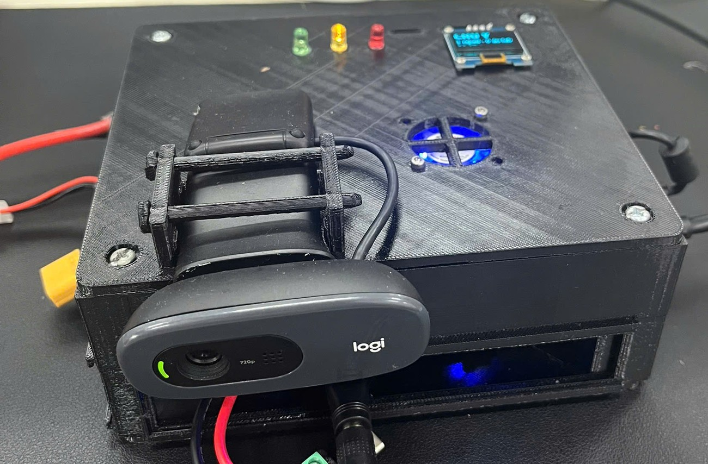
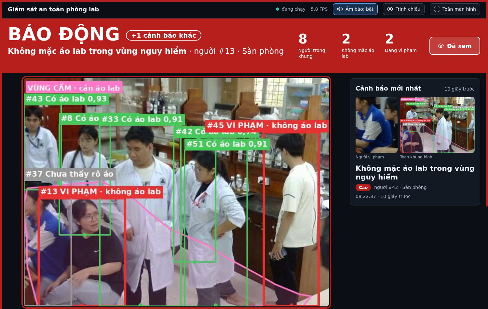
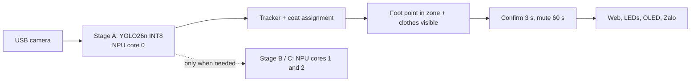

# Edge AI Smart Laboratory Safety Monitoring System

**First prize, EDGE AI DESIGN CHALLENGE 2026** (final round, 14 Nov 2026), Faculty of Electrical and Electronics Engineering, HCMC University of Technology and Engineering.

A small box that watches a laboratory camera and raises an alarm when a person **without a lab coat** steps into a **danger zone**. Everything that decides runs on the board's NPU: no video leaves the device. Built on an Orange Pi 5 (Rockchip RK3588S, 6 TOPS NPU) with a USB camera, three status LEDs, an OLED and a web dashboard.

[Demo video (32 s)](docs/media/demo_lab.mp4) · [Short paper (Vietnamese, 8 pages)](report/bai_bao_ngan.pdf) · [A2 poster](poster/poster_A2_in.pdf) · [Final-round slides](slides/chung_khao_edge_ai_lab_safety.pptx) · [Full report (Vietnamese)](report/bao_cao.pdf)

<p align="center">
  
  
</p>

## What it does

1. The camera frame goes to **YOLO26n (INT8) on the NPU**, which finds people and lab coats.
2. A tracker gives each person an id and assigns each coat box to exactly one person.
3. The **foot point** (bottom centre of the person box) is tested against a polygon the user draws on the web page.
4. A person is a violation only if: foot in the zone **and** no lab coat **and** the clothes are actually visible (a face at the edge of the frame or someone hidden behind another person is "cannot tell yet", never a violation).
5. The violation must last 3 s before it alarms, then the same person is muted for 60 s.
6. Output: web page with evidence photos, red LED + OLED on the device, optional Zalo text message (the only part that needs the Internet).

The system never shows SAFE when the camera feed is lost: it shows **NO SIGNAL**.

## Results (measured on the board)

| | Result | Notes |
|---|---|---|
| Speed | **about 30 FPS** (camera limit), 29.02 FPS with two extra models running | CPU-only FP32 reaches 10.5 FPS and 86.8 °C |
| Latency | stage A p50 25.9 ms (default clocks); whole pipeline p99 41.4 ms | the pipeline figure is on a looped 30 FPS video with the DDR clock pinned |
| INT8 accuracy | mAP50-95 **0.657** with split outputs vs 0.481 with the default export (FP32 0.661) | held-out session, 3 training seeds |
| Power | idle 0.86 W, product 2.20 W; adaptive 1.98 W vs run-everything 3.34 W | USB-C meter, about ±10%, replayed video, camera not included |
| Zone rule | 75–86% of coat-less people flagged, 7–9% false alarms | per person on still images, not per event |
| Stability | 24 h continuous run, RAM 210–220 MB, 0 errors | one run, one configuration |

Full numbers, how each was measured and what is **not** measured: [docs/results.md](docs/results.md), [docs/competition-claims.md](docs/competition-claims.md).

## Engineering that made the numbers

- **INT8 with split outputs.** The default INT8 export puts box coordinates (0–640 px) and class scores (0–1) in one tensor with one 8-bit scale, so each quantisation step is about 2.5 px and box edges drift: mAP50-95 falls by 18 points. Exporting six raw tensors (box and class per scale), each with its own scale, and decoding on the CPU loses only 0.4 points.
- **A parity gate before any speed number.** Every converted model is run on the same images through ONNX and the NPU and compared (recall, precision, IoU). It caught four silent conversion failures that still produced fast, plausible-looking output (see [KNOWN_ISSUES.md](KNOWN_ISSUES.md)).
- **Adaptive scheduling.** Secondary models run asynchronously on their own NPU cores and only when needed: 1.98 W instead of 3.34 W at the same frame rate. Speed comparisons had to pin the DDR clock, otherwise the governor measured itself.
- **Data with few labels.** Choosing hard frames beat using a bigger model; adding 238 COCO images of ordinary white clothes cut "white T-shirt called a lab coat" from 20/20 to 0–4/20 test images.
- **Honest failure analysis.** Moving the camera to a very different angle made the model miss every coat (0/122 frames). The report documents this, how it was found and how to avoid it.



## Repository map

| Path | What |
|---|---|
| `src/labsafe/` | pipeline, tracker, zone rule, NPU/ONNX backends, web dashboard, LED/OLED panel, Zalo notifier |
| `scripts/` | export (split-output INT8), parity gate, evaluation, board deployment, measurement tools |
| `configs/` | pipeline, class and zone configuration for board and laptop |
| `tests/` | about 350 unit tests, no camera or board needed |
| `docs/` | measurement protocol, results, optimisation notes, rules of the competition |
| `report/`, `poster/`, `slides/` | the written deliverables (Vietnamese) and their LaTeX / deck sources |
| `KNOWN_ISSUES.md` | every non-obvious bug found, with cause and how it was verified |

## Run the tests

```bash
python3 -m venv .venv && . .venv/bin/activate
pip install numpy opencv-python pyyaml psutil onnxruntime pillow pytest
PYTHONPATH=src python -m pytest tests -q
```

## What is not in this repository

- **Model weights and the labelled dataset.** The dataset contains photos of people and the weights were trained on it, so they are not published. The export, parity and evaluation scripts are included.
- **Credentials.** The Zalo bot token and the board password live in git-ignored `secrets/`.
- Running the live system needs the board, the camera and trained weights.

## License

The code, scripts and documents written by the team are released under the [MIT License](LICENSE). The export scripts use third-party tools with their own licences (for example Ultralytics YOLO is AGPL-3.0 and Rockchip's RKNN toolkit has its own terms); check them before redistributing models you train or convert with them.

## Team

Lê Tự Thiện An (team leader), Trịnh Anh Văn, Võ Nhật Nam, Phạm Trọng Thành.

---

## Tóm tắt (tiếng Việt)

Thiết bị giám sát an toàn phòng thí nghiệm chạy hoàn toàn trên NPU của Orange Pi 5: phát hiện người không mặc áo blouse bước vào vùng nguy hiểm do người dùng tự vẽ, cảnh báo qua trang web (kèm ảnh bằng chứng), đèn LED, màn OLED và tin nhắn Zalo. Hệ thống đạt khoảng 30 khung hình/giây, độ trễ p99 41,4 ms, 2,2 W, ổn định 24 giờ. Đóng góp chính: lượng tử hóa INT8 với đầu ra tách (mất 0,4 điểm mAP thay vì 18 điểm), bước kiểm tra tương đương NPU–CPU, chế độ thích nghi (1,98 W so với 3,34 W), và luật cảnh báo chỉ kết luận khi thấy rõ trang phục. Mọi số liệu ghi rõ cách đo và hạn chế; xem [báo cáo](report/bao_cao.pdf), [bài báo ngắn](report/bai_bao_ngan.pdf) và [docs/results.md](docs/results.md).
